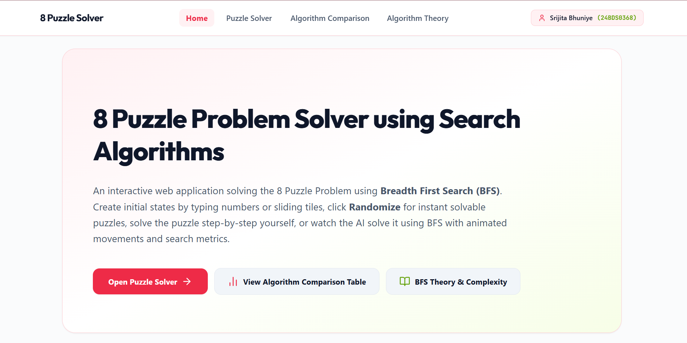
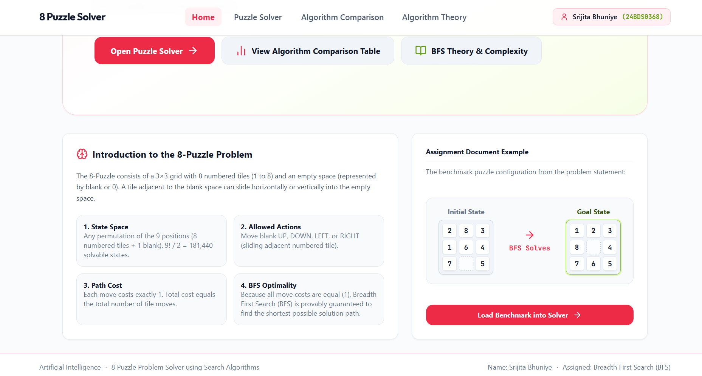
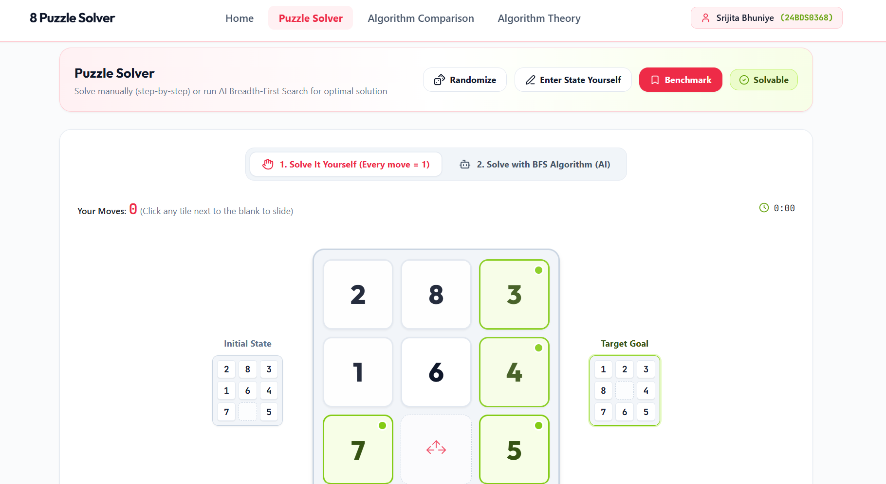
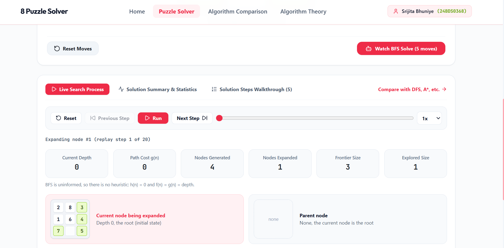
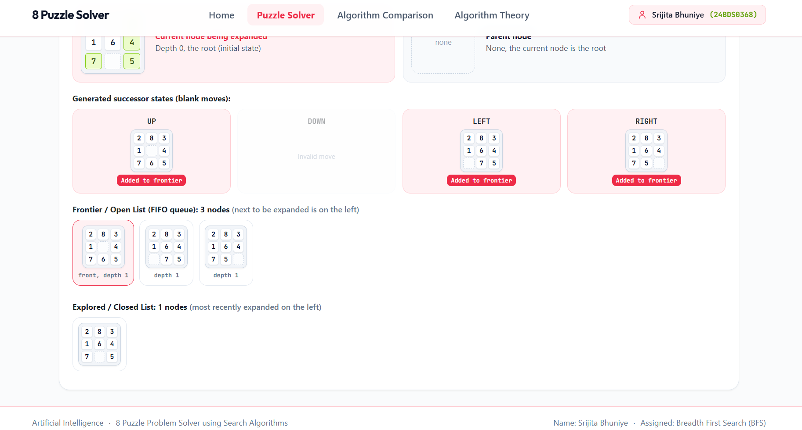
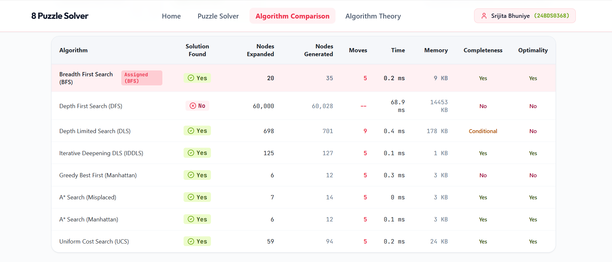
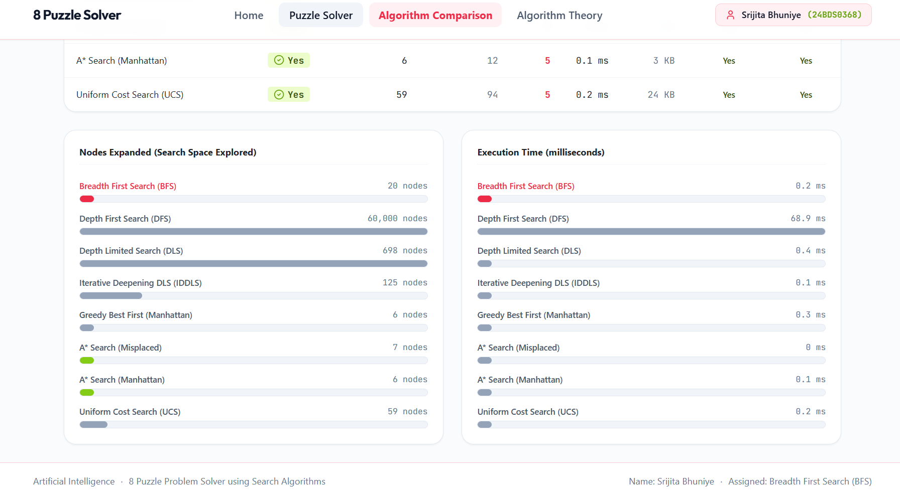
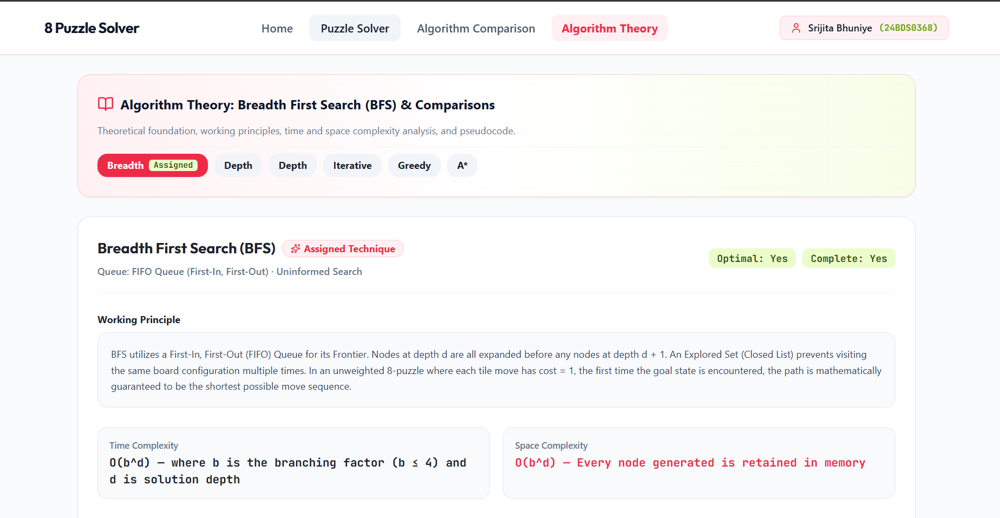

# AI-8Puzzle-Visualizer (8 Puzzle Solver)

Interactive 8-Puzzle solver that visualizes the **Breadth First Search (BFS)** state-space search algorithm.

- **Course:** Artificial Intelligence
- **Assignment:** Interactive 8-Puzzle Problem Solver using AI Search Algorithms
- **Student:** Srijita Bhuniye
- **Registration Number:** 24BDS0368
- **Live site (GitHub Pages):**(https://github.com/Srijita-b02/8puzzlesolver)

## Technologies Used
HTML5, CSS3, JavaScript (ES6), React, Vite, Tailwind CSS, lucide-react (icons), canvas-confetti.

## Search Algorithm Implemented
Breadth First Search (BFS) — FIFO queue frontier, explored set, early goal test, parent pointers to rebuild the solution path.
(Other search algorithms are also included in `src/algorithms/` for the comparison page.)

## Heuristics Used
BFS is uninformed and uses no heuristic. Misplaced Tiles and Manhattan Distance are used only by GBFS / A* on the comparison page.

## Screenshots










## How to Run the Project
Prerequisite: Node.js 20+

```
npm install
npm run dev
```
Then open the address printed in the terminal (usually http://localhost:3000).

## Build and Deploy (GitHub Pages)
```
npm run build
```
Publish the contents of the `dist` folder with GitHub Pages.

## References
- Russell & Norvig, *Artificial Intelligence: A Modern Approach* (search algorithms)
- React, Vite, Tailwind CSS, lucide-react, canvas-confetti documentation
- Code was generated with AI assistance (Google AI Studio) and reviewed/understood by the student. <edit as appropriate>
